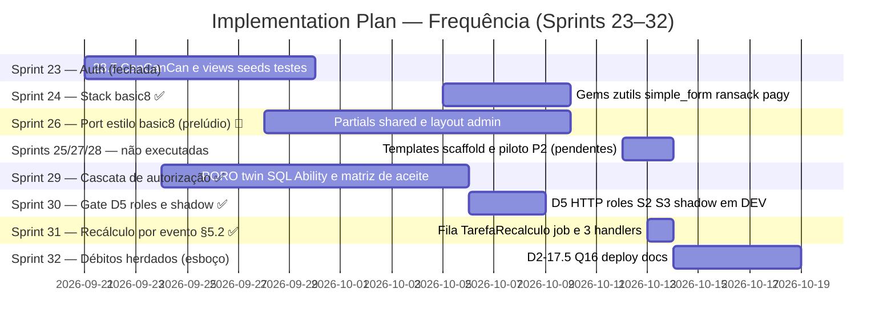

# Implementation Plan — Frequência

> Versão: 2 | Data: 2026-10-14 | Total de sprints: 9 (Sprints 24–32; Sprint 23 fechada)
>
> **Fontes:** `docs/PRD-SCAFFOLD-ESTILO-BASIC8.md` (RFs/RNs — Sprints 24–28) · `PRD-REGRAS-NEGOCIO-PRESENCA.md` (Sprints 29–32, derivadas do §9 "gaps priorizados") · `PRD-FREQUENCIA.md` (baseline histórico) · ADRs `0006`–`0011`.
>
> **Encadeamento:** inicia após a tarefa 23.7 (Sprint 23 — integração CanCanCan nos controllers).
>
> **Escopo desta versão:** o plano deixa de ser exclusivo da linha "scaffolds basic8" (v1, Sprints 24–28) e passa a cobrir a história real do projeto. As Sprints **29/30/31 estão concluídas** e a **32 está esboçada** (macro). Ver a nota de reconciliação abaixo antes de ler os épicos.

---

## Reconciliação de numeração e cobertura (nota obrigatória)

A v1 deste plano descrevia **apenas** a linha de scaffolds/CRUD basic8 (Sprints 24–28) e assumia que a sequência 24→28 seria executada na ordem planejada. **Isso não aconteceu.** O confronto plano × `docs/progress/iteration_*.md` revela divergências que precisam ficar registradas (não silenciadas):

| Sprint do plano (v1) | O que realmente rodou (`docs/progress/`) | Status real |
|---|---|---|
| 24 — Stack basic8 | `iteration_24.md` — mesmo escopo | ✅ **Concluída** (2026-10-05→10-09) |
| 25 — Templates de scaffold | *(sem `iteration_25.md`)* | ⬜ **Não executada** como sprint própria; RF04–RF13 parcialmente cobertos pelo port de estilo da iteration 26; os **templates de scaffold** do PRD basic8 seguem pendentes |
| 26 — Piloto regimes/versoes | `iteration_26.md` = **"Port de Estilo basic8 (prelúdio dos scaffolds)"** — escopo **diferente** do planejado | 🔵 **Divergência de escopo** — a iteration 26 real **não** é o piloto regimes/versoes; implementação consolidada no commit `1a73a4d` (branch `feat/demanda-port-estilo-basic8-fase2`), aguardando review/verificação visual |
| 27 — Piloto estacoes + pagy users/frequentadores | *(sem `iteration_27.md`)* | ⬜ **Não executada** (a troca de paginação kaminari→pagy dos pilotos não foi feita) |
| 28 — Remoção do kaminari + validação | *(sem `iteration_28.md`)* | ⬜ **Não executada** (kaminari segue no Gemfile) |
| — | `iteration_29.md` + `iteration_29_closure.md` | ✅ **Concluída** — cascata de autorização (PRD §3/§9 #1) |
| — | `iteration_30.md` | ✅ **Encerrada** — gate D5, roles granulares, débitos S2/S3, rollout shadow (PRD §9 #2/#7) |
| — | `iteration_31.md` | ✅ **Encerrada** — fila de recálculo por evento (PRD §5.2 / §9 #3) |

**Consequências (factuais, para decisão do dev/PO):**
1. As Sprints **25, 27 e 28 do plano nunca foram executadas** — não podem ser marcadas como concluídas. A linha basic8 produziu **24 (concluída)** + **26 (port de estilo, escopo redefinido)** e ficou **inacabada** (templates + piloto + remoção do kaminari pendentes).
2. A **numeração avançou pelo PRD de Regras de Negócio**, não pela linha basic8: 29/30/31 atacam os gaps §9 do `PRD-REGRAS-NEGOCIO-PRESENCA.md`.
3. O plano v1 **não tinha entrada** para 29–31 (gap de rastreabilidade declarado nas próprias iterations 29/30/31). Esta v2 corrige.

> ⚠️ **Ponto pendente de decisão (não resolvido aqui):** *a linha basic8 (templates de scaffold + piloto P2 + remoção do kaminari) foi abandonada ou apenas pausada?* As Sprints 25/27/28 permanecem listadas como **não executadas** e o dev/PO precisa decidir se voltam ao horizonte. Não as movo para "concluídas" nem as apago.

---

## Visão Geral

O projeto Frequência (migração do módulo `presenca` da Intranet para Rails 8) correu, até aqui, em **duas linhas de trabalho distintas**, não numa única sequência linear:

1. **Linha basic8 (Sprints 24–26, inacabada):** padronizar CRUDs administrativos no estilo do app de referência `basic8` — gems `zutils`/`simple_form`/`ransack`/`pagy`, wiring do pagy no stack admin, port de estilo (partials `shared/*`, layout, JS/UX) e (pendente) templates de scaffold com piloto P2 e remoção do kaminari. A Sprint 24 concluiu a stack; a Sprint 26 entregou o prelúdio de estilo; as Sprints 25/27/28 não foram executadas.
2. **Linha PRD de Regras de Negócio (Sprints 29–32):** fechar os **gaps priorizados do §9** do `PRD-REGRAS-NEGOCIO-PRESENCA.md` a partir da varredura do legado. A **Sprint 29** substituiu o baseline "todo autenticado lê tudo" pela **cascata de autorização** do legado (ADR-0010); a **Sprint 30** expôs o gate D5, semeou/migrou as roles granulares da cascata, fechou os débitos S2/S3 e produziu o insumo de rollout `:shadow`; a **Sprint 31** materializou o **mecanismo estrutural de recálculo por evento** do PRD §5.2 — fila persistente + job de despacho + handlers (ADR-0011). A **Sprint 32** (esboço) é uma sprint de **hardening/débitos herdados** (guarda de mês finalizado no job 17.5, cauda do período do vínculo, deploy da migration, governança de docs).

**Estado de autorização (transversal):** a cascata está implementada, provada e **não vigente** — flag `FREQUENCIA_AUTORIZACAO_CASCATA` default `:off`; a decisão de virar `:on` foi **resolvida** (dev, `d50f317`): **ativar quando todas as roles estiverem prontas** — hoje está bloqueada pela migração de atribuição (30.9b a 87,9% de não-resolvidos, acima do limiar de 10%).

---

## Diagrama Gantt

---

## Épicos

### Épico 1 — Stack basic8 (gems + configuração) — Sprint 24 ✅

Adoção das gems de referência e exposição do pagy no stack admin. Instala `zutils`, `simple_form`, `ransack` e `pagy`; gera o initializer do simple_form (wrapper Bootstrap 5 + locale pt-BR); expõe `Pagy::Backend` no `Admin::ApplicationController` e `Pagy::Frontend` no `ApplicationHelper`; mantém o flash local do layout admin (RF14) sem adotar partials `shared/flash*`. Não altera auth/banco (RNF06).

- Sprints: 24 · Status: **concluído** (`iteration_24.md`)

### Épico 2 — Port de estilo e templates de scaffold basic8 — Sprints 25/26 ⬜🔵

Porta para o Frequência o **delta de estilo** do basic8 (helpers de contexto, partials `shared/*`, layout admin, assets/build, bibliotecas JS/UX) como **pré-requisito visual** dos templates de scaffold, e depois os **próprios templates** (`lib/templates/` → controller herdando `Admin::ApplicationController` com `load_and_authorize_resource` + `ransack` + `pagy` + notices pt-BR; views em `shared/*`; gerador flat; convenções `self.icon` + `ransackable_*`; Stimulus `filtering`; bootstrap-table inert).

- Sprints: 25, 26
- **Status:** o **port de estilo** foi executado fora de ordem na `iteration_26.md` (🔵 em revisão/consolidado, commit `1a73a4d`) e **absorveu parte dos RF04–RF13**; os **templates de scaffold** (Sprint 25 nominal) e a **validação do gerador flat** seguem **não executados**. Épico **inacabado**.

### Épico 3 — Piloto P2 e consolidação (single-gem pagy) — Sprints 27/28 ⬜

Prova o template e unifica a paginação. Migra `regimes`/`versoes` (via generator) e `estacoes` (manual) para o novo estilo; troca **somente a paginação** de `users`/`frequentadores` para pagy (RN02 — exceção bespoke documentada); remove o kaminari e apaga `app/views/kaminari/`; valida a suíte (RNF04).

- Sprints: 27, 28 · Status: **não executado** (nenhum `iteration_27/28.md`; kaminari ainda presente)

### Épico 4 — Cascata de autorização de frequência — Sprint 29 ✅

Substitui o baseline "todo autenticado lê tudo" (Sprint 23.7) pela **cascata de autorização** do legado (`RegistroFrequenciaValidator.frequentador` / `RegistroFrequenciaServices.podeDesconsiderarFrequencia`) no domínio de frequência, com **dual-implementação canônica** (PORO de consulta `AutorizacaoFrequencia` × scope SQL `FrequentadoresVisiveis`, sem JOIN cross-database), **elegibilidade de desconsideração** (`ElegibilidadeDesconsideracao`, gate só do passo 5 — D5), integração na `Ability`/6 controllers e **matriz de aceite** (12 cenários). Rollout por **feature flag de 3 estados** (`:off` default / `:shadow` / `:on`).

- Sprints: 29 · Status: **concluído** (`iteration_29.md`, `iteration_29_closure.md`) · Consolidação durável: **ADR-0010**

### Épico 5 — Roles granulares e rollout da cascata — Sprint 30 ✅

Dá **ponto de entrada HTTP** ao gate D5 (desconsiderar) atrás da flag; **rulinga** e materializa o mínimo das roles do legado (PRD §9 #2): semeia + migra 1:1 as 2 roles que a cascata consome (`visualiza_frequentadores`/`visualiza_terceirizados`); fecha os débitos 🟡S2 (twin SQL cego ao PORO) e 🟡S3 (`frequencia_por_orgao` fora do grão da matriz); **garante o `User` local dos gestores de unidade** (furo dos 24 sem lotação vigente); e produz o **insumo de rollout** do modo `:shadow` (observação em DEV). Sob **política incremental** (ruling 30.3 = A emendado): cada role futura nasce na tarefa que implementa a seção do PRD que a consome.

- Sprints: 30 · Status: **encerrado** (`iteration_30.md`) · Emenda de conformidade: **ADR-0010 regra 9** (enforcement opt-in)

### Épico 6 — Recálculo assíncrono por evento (PRD §5.2) — Sprint 31 ✅

Materializa o **mecanismo estrutural** de recálculo em lote por evento do legado (`presenca_historicotarefa` + job `ExecutaTarefas`) que não tinha equivalente no Frequência: **fila persistente** `TarefaRecalculo` + `enfileirar!` idempotente (índice UNIQUE parcial) × **job de despacho** `ExecutaTarefasJob` (cron `*/5`, advisory lock próprio) × **registry de handlers** por `tipo_entidade`; handlers dos 3 eventos cujo domínio existe (`REGISTRO_FREQUENCIA`/`REGISTRO_ESTACAO`, `RECALCULAR_TODOS`, `VINCULAR_DESVINCULAR`) + produtores. Tipos `FERIADO`/`DIAEXCEPCIONAL`/`DIREITO` **declarados e adiados** (models inexistentes).

- Sprints: 31 · Status: **encerrado** (`iteration_31.md`) · Consolidação durável: **ADR-0011**

### Épico 7 — Hardening e débitos herdados — Sprint 32 (esboço)

Sprint de **dívida técnica e governança** que fecha os débitos herdados das Sprints 30/31 e a operação pendente. **Escopo macro restrito** aos candidatos abaixo (não inventar outros):

- **D2/17.5** — adicionar **guarda de mês finalizado** ao `CalcularFrequenciaJob` (recálculo dos últimos 3 dias sem a trava 17.2; mesmo padrão do bug A da 31.3, porém **pré-existente**). O handler de recálculo por evento **espelha** o job — a correção tem de nascer **no job**, senão cria divergência.
- **Q16 (31.5)** — decidir/implementar o recálculo da **"cauda"** do período ao **encolher** `momento_final` de um vínculo (dias após o novo fim ficam com `CalculoDiario` stale). Decisão do dev: manter o literal ("dias do período") × estender o handler.
- **Q15** — **quadro real de devs**: o plano da 31 assumiu Dev A/Dev B; a execução foi sequencial. Ajustar para dimensionar o paralelismo das próximas sprints (planejamento/retrospectiva).
- **Deploy da migration `create_tarefas_recalculo` (31.1)** — aplicada só no banco de **teste local**; falta `db:migrate` no **dev remoto** antes de qualquer uso do mecanismo fora do teste.
- **Governança de docs** — corrigir o **cabeçalho defasado do `docs/README.md`** (estado do projeto datado de 2026-08-05; Fases 4+ ainda "suspensas") e o **`CLAUDE.md` do workspace** que aponta a documentação para `pessoas2/docs/` (árvore do **outro** projeto) em vez de `Frequencia/docs/`.

- Sprints: 32 · Status: **esboçado (macro)** — o detalhamento é do Sprint Planner

**Horizonte seguinte (Sprint 33+ — não comprometido, derivado de gaps já documentados):** tipos de recálculo adiados (`FERIADO`/`DIAEXCEPCIONAL`/`DIREITO` — exigem models de domínio inexistentes); gaps remanescentes do PRD §9 — #4 (cap de banco de horas + 4 flags administrativas por dia), #6 (`isPermitidoModalidadeOcorrencias`), #8 (divergência da modalidade `OCORRENCIAS` com 2+ marcações); débito **estrutural** do enforcement opt-in da cascata (ADR-0010 regra 9 — causa-raiz do Bug 🔴1); e a **revisita do Bug 🟠2** (`/presenca/*` sem autenticação — risco aceito, gatilho: fim dos testes manuais da Estação). *Nada aqui está agendado; são candidatos rastreados, não compromissos.*

---

## Sprints

> Convenção: sprints 24–28 são a linha basic8 (v1 do plano); 29–32 são a linha PRD de Regras de Negócio. Sprints com "não executada" **não** foram marcadas como concluídas.

### Sprint 24 — Stack basic8 (gems + wiring) ✅

- Status: ✅ Concluída (`iteration_24.md`; 2026-10-05→10-09)
- Goal: Adotar as gems de referência (zutils, simple_form, ransack, pagy) e expor o pagy no stack admin sem alterar auth/banco.
- Escopo macro: Gemfile com `zutils ~> 4.0`, `simple_form ~> 5.4`, `ransack ~> 4.4`, `pagy ~> 9` + bundle; `simple_form:install` com wrapper Bootstrap 5 e locale pt-BR; `include Pagy::Backend` no `Admin::ApplicationController` e `include Pagy::Frontend` no `ApplicationHelper`; validação de compatibilidade Rails 8 API-only e do flash local (RF14); smoke test de carga das gems.
- Dependências: conclusão da tarefa 23.7 (Sprint 23).
- Estimativa: 1 semana
- RFs cobertos: RF01, RF02, RF03, RF14

### Sprint 25 — Templates de scaffold + convenções de modelo ⬜

- Status: ⬜ **Não executada** como sprint própria (sem `iteration_25.md`); parte de RF04–RF13 foi absorvida pelo port de estilo da iteration 26, mas os **templates de scaffold** do PRD basic8 não foram portados.
- Goal: Portar os templates do basic8 adaptados ao Frequência e validar o gerador flat com as convenções de modelo (RN04).
- Escopo macro: `lib/templates/rails/scaffold_controller/controller.rb.tt` adaptado (herda `Admin::ApplicationController`, `load_and_authorize_resource` + ransack + pagy + notices pt-BR) e `lib/templates/erb/scaffold/*` renderizando `shared/*`; prova de conceito `rails g scaffold Modelo` (flat → `Admin::` + rotas manuais no `scope module: "admin"`); controller Stimulus local `filtering`; `shared/index` inert (bootstrap-table); documentação das convenções `self.icon` + `ransackable_*` (RN04/RF06/RF07).
- Dependências: Sprint 24
- Estimativa: 1 semana
- RFs cobertos: RF04, RF05, RF06, RF07, RF11, RF12, RF13

### Sprint 26 — Port de estilo basic8 (prelúdio dos scaffolds) 🔵

- Status: 🔵 **Divergência de escopo** — a iteration 26 real **não** é o "Piloto regimes/versoes" planejado na v1; é o **port de estilo** (partials `shared/*`, layout admin, assets/build, JS/UX). Implementação consolidada no commit `1a73a4d` (branch `feat/demanda-port-estilo-basic8-fase2`), aguardando review/verificação visual.
- Goal (real): Portar TODO o delta de estilo do basic8 como pré-requisito visual dos scaffolds (Sprint 25 nominal).
- Escopo macro: helpers de contexto, partials `shared/*`, layout admin, assets/build, bibliotecas JS/UX. **Não** entrega os templates de scaffold.
- Dependências: Sprint 24
- RFs cobertos: RF04, RF05, RF06, RF12, RF13, RF14, RNF01, RNF03, RNF05, RNF06 (parcial — parte dos templates segue pendente)

### Sprint 27 — Piloto P2: estacoes manual + paginação pagy em users/frequentadores ⬜

- Status: ⬜ **Não executada** (sem `iteration_27.md`)
- Goal: Migrar `estacoes` manualmente no mesmo estilo e trocar a paginação de `users`/`frequentadores` para pagy, preservando os recursos bespoke.
- Escopo macro: reescrever `admin/estacoes` com os mesmos partials/padrões; `@pagy, @vinculos = pagy(...)` nos controllers de `users`/`frequentadores` e `pagy_info`/`pagy_nav` nas views, removendo `paginate`/`total_count`/`offset_value`/`.page(` (RN02 — exceção bespoke documentada).
- Dependências: Sprint 26 (e o piloto regimes/versoes da Sprint 26 planejada, que não ocorreu)
- Estimativa: 1 semana
- RFs cobertos: RF08 (parcial), RF09, RF06, RF07

### Sprint 28 — Remoção do kaminari + validação final ⬜

- Status: ⬜ **Não executada** (sem `iteration_28.md`; kaminari ainda no Gemfile)
- Goal: Consolidar pagy como dependência única de paginação e validar os critérios de aceite do PRD (RNF04).
- Escopo macro: remover gem `kaminari` + `bundle install`; apagar `app/views/kaminari/`; varrer o app por resíduos (`paginate`, `.page(`, `total_count`, `offset_value`); rodar suíte completa, `rails zeitwerk:check` e rubocop; checagem dos critérios de aceite 1–8 do PRD basic8 e ausência de regressão em auth/ability (RNF06).
- Dependências: Sprint 27
- Estimativa: 1 semana
- RFs cobertos: RF10; valida RF09/RF08/RF04/RF05/RF11/RF12 e RNF04/RNF06

### Sprint 29 — Cascata de autorização de frequência ✅

- Status: ✅ Concluída (`iteration_29.md`, `iteration_29_closure.md`; branch `integration/sprint-29`)
- Goal: Substituir o baseline "todo autenticado lê tudo" pela cascata de autorização do legado e pela regra de elegibilidade de desconsideração, com `GestorIndividual` migrado do Intranet.
- Escopo macro: schema de teste do espelho Pessoas (29.0); exposição de hierarquia/gestores de órgão no espelho (`Pessoas::Unidade#gestor?/#cadeia_ascendente`); schema aditivo de `GestorIndividual` + importação idempotente do Intranet; **cascata de visualização** (PORO `AutorizacaoFrequencia`/29.4 + scope SQL `FrequentadoresVisiveis`/29.6, sem JOIN cross-database); **elegibilidade de desconsideração** (`ElegibilidadeDesconsideracao`/29.5 — gate **só** do passo 5, D5); integração na `Ability` + 6 controllers (29.7) atrás da **feature flag** `FREQUENCIA_AUTORIZACAO_CASCATA` (`:off`/`:shadow`/`:on`); **matriz de aceite** (12 cenários) + auditoria de negação (29.8).
- Dependências: Sprint 23.7 (CanCanCan nos controllers); domínios disjuntos das Sprints 24–28.
- Estimativa: 2 semanas
- Rastreabilidade (PRD/ADR): `PRD-REGRAS-NEGOCIO-PRESENCA.md` §2.3, §2.5, §3, §9 itens 1 e 7 · **ADR-0010** (consolidação durável)

### Sprint 30 — Gate D5, roles granulares, débitos S2/S3 e rollout shadow ✅

- Status: ✅ Encerrada (CTO, 2026-10-08) — `iteration_30.md`
- Goal: Dar ponto de entrada HTTP ao gate de desconsideração (D5) atrás da flag; rulingar as roles granulares do legado; materializar o mínimo que dá valor à cascata; fechar os débitos S2/S3 e produzir o insumo de rollout do modo `:shadow`.
- Escopo macro: **gate D5** exposto em `POST /time_records/:id/desconsiderar` sob a flag (30.1/30.2); **ruling** das roles + política incremental (30.3 = A, emendado); **débitos** 🟡S2 (twin SQL × PORO no passo 4) e 🟡S3 (`frequencia_por_orgao` no grão da matriz) fechados (30.6/30.7); **2 roles da cascata** semeadas (30.9a) + **migração 1:1 do legado** (30.9b, read-only, limiar de aborto de 10%); **`User` local dos gestores de unidade** garantido a partir do Pessoas (30.10, furo dos 24 sem lotação vigente); **observação do modo `:shadow`** em DEV (30.8, re-escopada — não há produção).
- Dependências: Sprint 29 (consome `AutorizacaoFrequencia`, `FrequentadoresVisiveis`, `ElegibilidadeDesconsideracao`, `FrequenciaAutorizacaoCascata`).
- Estimativa: 1 semana
- Rastreabilidade (PRD/ADR): `PRD-REGRAS-NEGOCIO-PRESENCA.md` §2.3, §2.5, §3, §9 itens 2 e 7 · **ADR-0010** (regras 4/6/7 + **emenda regra 9** — enforcement opt-in)
- Pendências não bloqueantes: decisão de `:on` (`d50f317` — **resolvida**: ativar quando todas as roles estiverem prontas; hoje bloqueada pela execução da 30.9b a 87,9% de não-resolvidos); Bug 🟠2 (`/presenca/*` sem auth) = risco aceito com gatilho de revisita.

### Sprint 31 — Fila assíncrona de recálculo por evento (PRD §5.2) ✅

- Status: ✅ Encerrada (CTO, 2026-10-13) — `iteration_31.md`; pilha linear `b417fef → 97095bc → b50e425 → e13f782 → dae631f` (+`1fa033e`)
- Goal: Materializar o mecanismo estrutural de recálculo em lote por evento do PRD §5.2 (gap §9 #3) — fila persistente + job de despacho ~5min + handlers dos eventos com domínio existente, deixando `FERIADO`/`DIAEXCEPCIONAL`/`DIREITO` explicitamente adiados.
- Escopo macro: fila/model `TarefaRecalculo` + `enfileirar!` idempotente (31.1, índice UNIQUE parcial + savepoint); job `ExecutaTarefasJob` com advisory lock **próprio** `728_104_536` + registry de handlers (31.2); handlers `REGISTRO_FREQUENCIA`/`REGISTRO_ESTACAO` (31.3, trava 17.2 no dia + nunca dia futuro), `RECALCULAR_TODOS` (31.4, eixo `Pessoas::Vinculo.ativos`), `VINCULAR_DESVINCULAR` (31.5, produtor `after_commit` em `RegimeFrequentador` — Q14).
- Dependências: infra de recálculo existente (`CalculoDiarioService`, `ConsolidacaoMensalService`, `CalcularFrequenciaJob` — 17.5) intacta. **Nenhum acoplamento com autorização.**
- Estimativa: 1 semana (14 pontos, execução sequencial)
- Rastreabilidade (PRD/ADR): `PRD-REGRAS-NEGOCIO-PRESENCA.md` **§5.2 (L139–148)** e **§9 item 3 (L201)** · **ADR-0011** (consolidação durável)

### Sprint 32 — Hardening e débitos herdados (esboço) ⬜

- Status: ⬜ Esboçada (macro) — aguarda detalhamento do Sprint Planner
- Goal: Fechar os débitos herdados das Sprints 30/31 e a operação pendente, sem introduzir funcionalidade nova.
- Escopo macro (candidatos — **não inventar outros**): guarda de mês finalizado no `CalcularFrequenciaJob` (D2/17.5); recálculo da "cauda" do período ao encolher o vínculo (Q16/31.5); quadro real de devs (Q15); deploy da migration `create_tarefas_recalculo` (31.1) no dev remoto; correção de governança de docs (cabeçalho do `docs/README.md` + `CLAUDE.md` do workspace apontando para `pessoas2/docs/`).
- Dependências: Sprints 30/31 (débitos) — sem dependência de código nova entre os itens.
- Estimativa: 1 semana (conservadora)
- Rastreabilidade (PRD/ADR): `iteration_31.md` §"Débitos Técnicos" · **ADR-0011** (regra 4/consequências — D2/17.5) · `iteration_30.md` §"Débito de rastreabilidade"

---

## Decisões Arquiteturais

### Linha basic8 (Sprints 24–26)

As decisões técnicas da feature de scaffolds foram fechadas no `PRD-SCAFFOLD-ESTILO-BASIC8.md` (registro D1–D6) e são adotadas pelo plano sem reabertura:

| # | Decisão | Escolha |
|---|---------|---------|
| D1 | Origem dos partials `shared/*` | Gem `zutils` 4.0.0 (engine) — convenção `Model.icon`, helpers via `ActionView::Base`, JS controllers locais, sem `zutils.scss` |
| D2 | Gems de formulário/busca | `simple_form ~> 5.4` + `ransack ~> 4.4`; initializer wrapper BS5 + locale pt-BR; whitelist `ransackable_*` |
| D3 | Paginação | `pagy ~> 9` — `@pagy, @collection = pagy(...)`; kaminari removido ao final do piloto (**pendente** — ver Sprints 27/28) |
| D4 | Namespace | Opção A — scaffold flat + template customizado; controller herda `Admin::ApplicationController`; views em `admin/`; rotas flat no `scope module: "admin"`; model flat |
| D5 | Coexistência | P2 — estacoes/regimes/versoes no novo estilo; users/frequentadores só paginação pagy; kaminari removido; sem override da zutils; bespoke = exceção documentada |
| D6 | Compatibilidade Rails 8 + API-only | Compatível — `Pagy::Backend`/`Frontend`, flash local mantida, filtering local, bootstrap-table inert |

### Linha PRD de Regras de Negócio (Sprints 29–32)

As decisões das linhas de autorização e recálculo foram consolidadas em ADRs (padrão de consolidação por mecanismo, não por tarefa):

| ADR | Mecanismo / decisão durável | Sprint |
|-----|-----------------------------|--------|
| 0006 | Schema de teste do espelho readonly do Pessoas (`frequencia_pessoas_espelho_test`) | 29 |
| 0007 | Soft-delete do vínculo de gestão individual + invariante de auto-gerência + política de deleção de `User` | 29 |
| 0008 | Semântica de estado do gestor individual (`ativo`) e reconciliação de identidade com o legado | 29 |
| 0009 | Toolchain Ruby 3.3.8 / Rails 8.1.x + lockstep das 3 fontes + política do ledger Brakeman | transversal |
| 0010 | Arquitetura da **cascata de autorização** — dual-implementação PORO × SQL, flag de 3 estados, regras 1–9 (regra 9 = enforcement opt-in, emenda 2026-10-08) | 29 · emenda 30 |
| 0011 | **Mecanismo de recálculo por evento** — fila persistente + registry de handlers + contrato de produtores (7 regras; Q14; tipos adiados) | 31 |

**Decisões de domínio relevantes (rulings, não ADRs próprias):** D1 (roles `visualiza_frequentadores`/`visualiza_terceirizados`), D4 (TERCEIRIZADO = **tipo de vínculo**), **D5** (ver ≠ desconsiderar — o acionador é **só** o passo 5), D6 (fail-closed), D8 (leitura nunca `valid?`), Q14 (`RegimeFrequentador` emite `VINCULAR_DESVINCULAR`), política incremental de roles (30.3 = A, emendado).

**Enforcement opt-in (débito estrutural, ADR-0010 regra 9):** a cascata é **opt-in por controller** (concern `FrequenciaAuthorization`); `authorize! :read, :all` satisfaz o `check_authorization` — logo **qualquer controller novo que leia `TimeRecord`/`Pessoas::Vinculo` vaza silenciosamente**. Causa-raiz do Bug 🔴1 da 30. Mitigação estrutural (central `before_action` ou teste de conteúdo obrigatório por tela de listagem) = **candidata ao horizonte (33+)**.

---

## Riscos do Projeto

| Risco | Severidade | Mitigação |
|---|---|---|
| **Linha basic8 inacabada (Sprints 25/27/28 não executadas)** — templates de scaffold, piloto P2 e remoção do kaminari pendentes; RF08–RF10 não entregues | 🟠 | Decisão do dev/PO: retomar a linha ou declará-la abandonada e ajustar o escopo do PRD basic8; hoje listada como **não executada** |
| **Numeração do plano historicamente divergente** (Sprint 26 real ≠ Sprint 26 planejada) | 🟡 | Esta v2 registra a reconciliação; futuras sprints mantêm a numeração real das iterations |
| **Enforcement opt-in da cascata** (ADR-0010 regra 9) — novo controller que leia frequência vaza silenciosamente, em **qualquer** valor da flag | 🟠 Alto | Emenda ADR-0010 regra 9; tarefa estrutural no horizonte (33+); até lá, disciplina de incluir o concern + teste de conteúdo |
| **Cascata não vigente** — flag `FREQUENCIA_AUTORIZACAO_CASCATA` default `:off`; migração de atribuição das roles (30.9b) bloqueada a 87,9% de não-resolvidos (> limiar 10%) | 🟠 | Decisão `d50f317`: ativar `:on` quando todas as roles estiverem prontas; desbloquear o eixo de casamento da migração antes |
| **D2/17.5** — `CalcularFrequenciaJob` recalcula os últimos 3 dias **sem** guarda de mês finalizado (pré-existente) | 🟠 | Tratado como **escopo da Sprint 32** (guard por dia no job; o handler espelha) |
| **Q16 (31.5)** — cauda do período não recalculada ao encolher o vínculo ⇒ `CalculoDiario` stale | 🟠 | Escopo da Sprint 32 (decisão do dev: literal × estender) |
| **Migration `create_tarefas_recalculo` (31.1) não aplicada no dev remoto** — mecanismo §5.2 não opera fora do teste | 🟠 (operacional) | Escopo da Sprint 32 (deploy/`db:migrate`) |
| **Bug 🟠2 — `/presenca/*` sem autenticação** (batidas do dia + hashes biométricos de terceiros a qualquer host) — **risco aceito**, não resolvido | 🔴 | Gatilho de revisita: fim dos testes manuais da Estação; opções: rede/allowlist · gate por ativação · aceitar por design (ADR-0003) |
| **TOCTOU residual de mês finalizado** (31.3/31.5) — guard `finalizado?` é "melhor esforço" | 🟢 | Documentado honestamente; reabrir se a finalização de mês passar a ser automatizada |
| **Crash-window do despacho** (31.2) — entre marcar `processada` e o efeito do handler | 🟢 | Idempotência mora nos handlers; retry sofisticado fora de escopo |
| **Divergência handler × job** — corrigir só o handler de recálculo criaria divergência com o `CalcularFrequenciaJob` | 🟡 | Toda correção da trava de mês finalizado nasce no **job 17.5** e é espelhada no handler (Sprint 32) |
| **Governança de docs defasada** — `docs/README.md` (estado de 2026-08-05) e `CLAUDE.md` do workspace apontando para `pessoas2/docs/` | 🟡 | Escopo da Sprint 32 (correção de cabeçalho/ponteiro) |
| **Baseline da suíte com defeitos pré-existentes** (15 ao fim da 31: 11× Devise `redirect_to` + 1× timezone + order-dependent do espelho/paralelização) | 🟢 | Toda medição isola as pré-existentes antes de atribuir regressão |
| **Regressão nas telas bespoke** (users/frequentadores) na troca de paginação — quando a Sprint 27 for retomada | 🟡 | Escopo mínimo (só paginação); suíte cobre `?page=`; exceção RN02 documentada |

---

*Plano macro. O detalhamento de tarefas atômicas de cada sprint é do **Sprint Planner** (`iteration_N.md`). Este arquivo não contém tarefas individuais.*
